[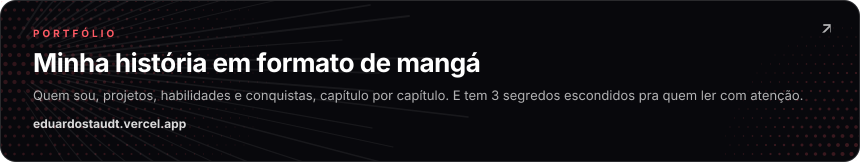](https://eduardostaudt.vercel.app/)

<a href="https://nnadsorption-app.web.app/">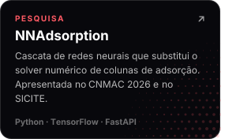</a><a href="https://glazzy.pages.dev">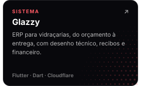</a><a href="https://thefenexy.itch.io/hero-maze">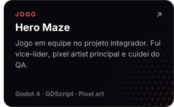</a>


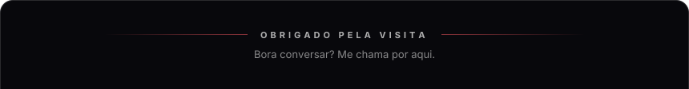<a href="https://www.linkedin.com/in/eduardo-andrei-staudt/">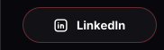</a><a href="https://www.instagram.com/eduardo_staudt_/">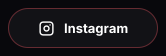</a><a href="https://www.youtube.com/@EduardoAndreiStaudt">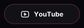</a><a href="mailto:programadorstaudt@gmail.com">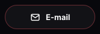</a><a href="https://eduardostaudt.vercel.app/curriculo">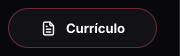</a>

